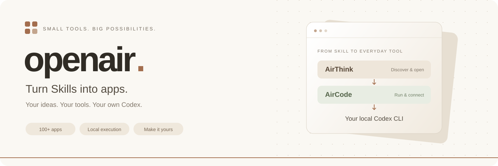
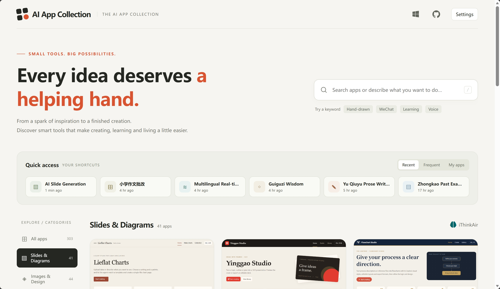

<p align="center">
  
</p>

<p align="center">
  <a href="README.md"></a>
  <a href="README.en.md"></a>
</p>

# openair

**Turn Skills into apps, making AI capabilities easier to use and manage.**

Skills are typically used through conversations in Agent. openair aims to turn those capabilities into apps you can open directly: choose a tool in your browser, enter your input, get results, and manage and expand your own app collection.

openair consists of two local services: **AirCode** and **AirThink**. AirCode lets apps use AI through your local Claude Code、Codex、Grok Build、DeepSeek Harness installation. AirThink provides an app collection with hundreds of apps and can receive your own apps deployed from iThinkAir to your local network.



## Why openair?

- **Give Skills an app interface**: Turn task workflows into interactive pages for everyday use.
- **Use your own Agent**: Apps call your local Agent CLI through AirCode, using your existing sign-in environment.
- **Make use of your subscription**: Use your Agent subscription to help reduce everyday costs and spending on usage-based model APIs. Actual costs and available usage depend on your subscription and usage patterns.
- **Discover and manage apps in one place**: Search apps, browse by category, and access your own apps from a single page.
- **Customize as needed**: Build apps on [iThinkAir](https://www.ithinkair.com), then click "Deploy to intranet" on an app's detail page to deploy it to your own local app collection.

## How It Works

```text
App in your browser
      │
      ▼
AirThink (3130)
App pages, files, and app management
      │
      ▼
AirCode (3131)
Task and workflow execution
      │
      ▼
Local Agent CLI
      │
      ▼
AI processes the task and returns results to the app
```

AirCode runs AI tasks through Agent CLI. Before using the apps, make sure the Windows user running the services can successfully use Agent from the command line.

## Quick Start

### 1. Set Up Your Environment

The current startup scripts target **Windows**. You will need:

- Python 3, with working `python` and `pip` commands.
- Agent CLI installed, signed in, and able to run tasks.
- A modern browser and a network connection for installing dependencies and accessing AI services.

Check your environment in PowerShell:

```powershell
python --version
python -m pip --version
```

Both services check for missing Python dependencies at startup and install them through pip. The first startup may take a while, so watch the output in the service windows. Some apps may also require additional tools or runtime environments.

### 2. Start the Services

Navigate to the `openair` directory and run:

```powershell
cd openair
.\start.bat
```

You can also open the `openair` folder in File Explorer and double-click `start.bat`.

The script starts AirThink and AirCode. Once it detects a service listening on port `3130`, it automatically opens:

**[http://127.0.0.1:3130/index.html](http://127.0.0.1:3130/index.html)**

Keep both service windows open while using the apps. AirCode may still be installing dependencies when the page opens; wait for it to finish starting before running AI tasks. Close both service windows when you are done to stop the services.

> The startup script first forcibly terminates any processes using ports `3130` and `3131`. Make sure these ports are not being used by other services you need to keep running.

### 3. Open an App

Search by keyword or browse by category on the app collection page, then click an app card to open it.

When accessing the local service at `127.0.0.1`, the collection opens apps directly. When accessing another internal server, enter a **User Key** if prompted. This is AirThink's local access key, separate from the iThinkAir API Key used to connect your local service, your Agent sign-in credentials, and any model API key:

- Keys are stored in `AirThink/apps/userkey.json` as a JSON array of strings. Before use, you can set it to your own key, for example `["your-own-local-key"]`.
- If the file does not exist, the first non-empty key submitted will be saved as the local key.
- After successful verification, your browser saves the key for future access.

## Included Apps

The collection includes hundreds of apps, organized into the same 10 categories shown on the app collection page:

| Category | Use Cases |
| --- | --- |
| Slides & Diagrams | Presentations, infographics, flowcharts, mind maps, and data visualization |
| Images & Design | Image generation and editing, posters and covers, SVG illustrations, and visual design |
| Video & Animation | Video scripts, storyboards, comics, animation, and video production |
| Writing & Copy | Articles and fiction, marketing copy, editing, and structured writing |
| Social & Cards | Xiaohongshu posts, social media graphics, knowledge cards, and publishing assets |
| Learning & Teaching | Problem explanations, study notes, classroom materials, homework, and essay feedback |
| Languages & Translation | Text and document translation, bilingual learning, speech recognition, and speech synthesis |
| Research & Office | Topic research, information organization, document processing, office automation, and analytical reports |
| Life & Growth | Everyday records, object recognition, planning and reflection, and personal development |
| Tradition & Humanities | Traditional culture, art and antiques, I Ching studies, and humanities content |

You can open these apps directly from the local collection. AI tasks run through your own Agent CLI installation.

## Create Apps and Deploy to Your Local Network

1. Visit [iThinkAir](https://www.ithinkair.com), or click the logo + "iThinkAir" link on the right side of the app collection.
2. Create an app for your needs, then open its detail page in your own app library.
3. Keep OpenAir (AirThink and AirCode) running on your local computer. Run ThinkClaw on the same computer and connect it using an API Key added and copied from iThinkAir's "Manage API keys" window. You can download ThinkClaw for Windows from that window.
4. Click "Deploy to intranet" (部署到内网) on the app's detail page. iThinkAir first checks whether your local service is online. If "Local service offline" appears, restore the service and use "Check connection" before retrying deployment.
5. After "Deployment succeeded" appears, reopen or manually refresh the local app collection, then find and run the app under "My Apps" (我的应用). If "Deployment failed" appears, see the troubleshooting advice below.

Deployment sends the app directly from iThinkAir to the local service connected to your current account. 

## Project Structure

```text
openair/
├── start.bat              # Starts both services and opens the browser
├── AirCode/
│   ├── app.py             # Task service entry point
│   ├── startweb.py         # HTTP server startup entry point (3131)
│   ├── run.bat
│   ├── worker/            # Workflows, AI calls, and task execution
│   ├── utilities/         # File handling, communication, and other utilities
│   └── SERVERFILES/       # Task files and Agent CLI working directory
└── AirThink/
    ├── app.py             # App, file, and communication services
    ├── startweb.py         # HTTP server startup entry point (3130)
    ├── run.bat
    ├── apps/              # App collection pages, app source code, and local configuration
    ├── files/             # App resources and uploaded files
    └── skills/            # Skill files and resources
```

AirThink also uses port `3133` for its WebSocket service.

## FAQ

**The browser did not open automatically, or the page is inaccessible.**

Check the output in the AirThink window to confirm that dependency installation has finished and the service has started successfully. Then open the [app collection page](http://127.0.0.1:3130/index.html) manually. When starting from the command line, make sure you first navigate to the `openair` directory, because the startup script uses relative paths.

**The page opens, but AI tasks produce no results.**

Check the output in the AirCode window to confirm that the service has started. Also verify that the same Windows user can successfully run Agent tasks in a terminal. 

**Deployment reports "Local service offline" or "Deployment failed".**

Make sure your local computer is on and connected to the network, with OpenAir's AirThink and AirCode services and ThinkClaw running. ThinkClaw must use an API Key from your current iThinkAir account. Once the service is available, use "Check connection", then retry "Deploy to intranet" on the app's detail page. If it still fails, check the AirThink and ThinkClaw windows for specific errors.

## Running the Services

The services currently listen on `0.0.0.0`. AirCode runs Agent tasks with `danger-full-access` and disables per-action approvals. Run the services and deploy apps only in a trusted personal environment. Do not expose the services directly to the public internet.

## Contributing

Bug reports, suggestions, and code contributions are welcome. When reporting an issue, include steps to reproduce it, error messages from the relevant service, and your Python and Agent CLI versions. Remove keys and personal data before sharing logs.
